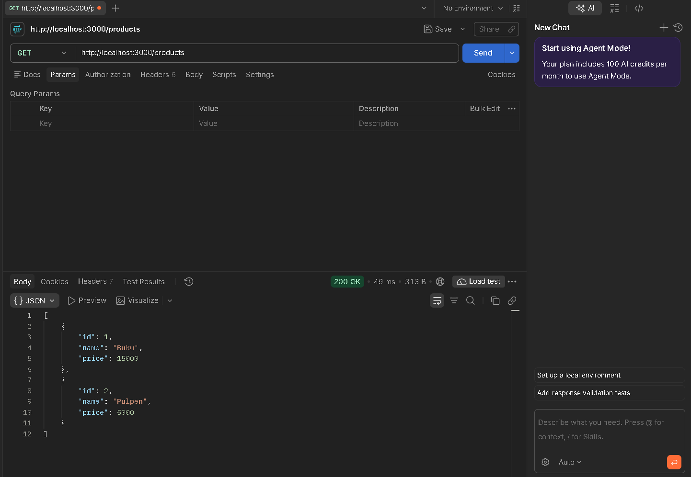
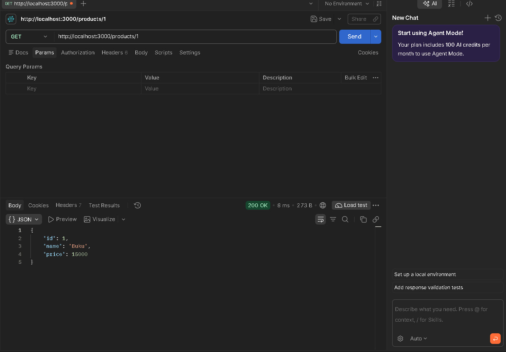
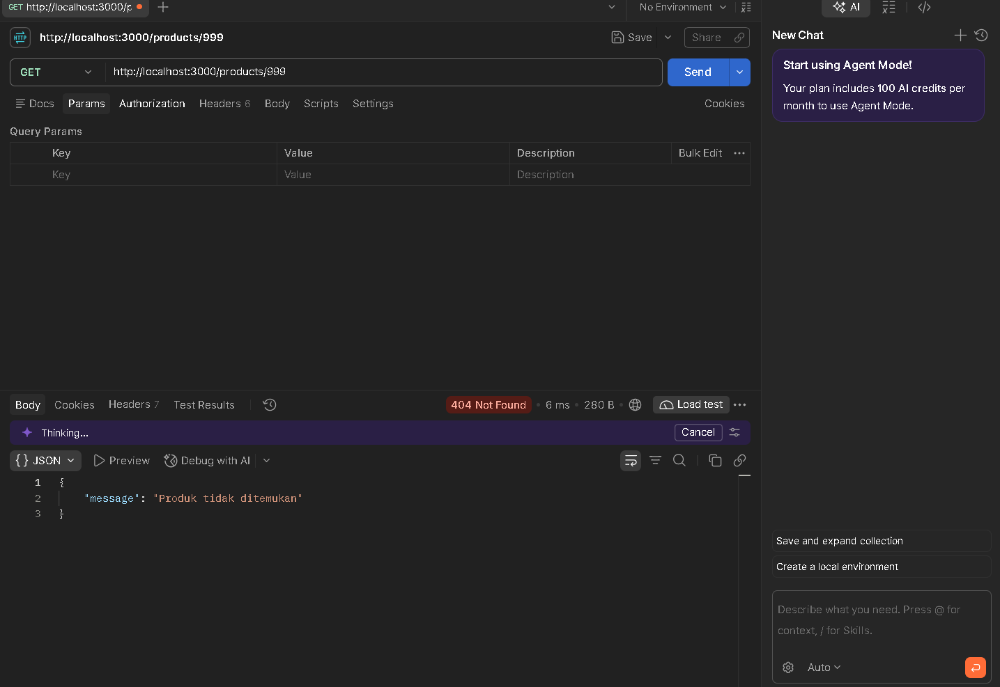
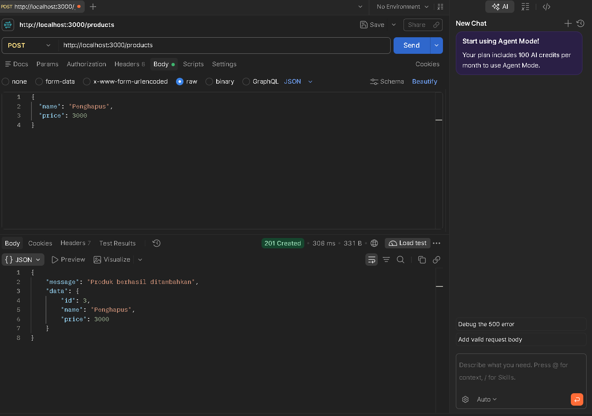

# TUGAS: API DAFTAR PRODUK

## Kode Proyek

`app.js`

```js
const express = require('express');
const productRoutes = require('./routes/productRoutes');

const app = express();

app.use(express.json());
app.use('/products', productRoutes);

app.listen(3000, () => {
    console.log('Server berjalan di port 3000');
});
```

`productRoutes.js`

```js
const express = require('express');
const router = express.Router();

const {
    getAllProducts,
    getProductById,
    createProduct
} = require('../controllers/productController');

router.get('/', getAllProducts);
router.get('/:id', getProductById);
router.post('/', createProduct);

module.exports = router;
```

`productController.js`

```js
const products = [
    { id: 1, name: 'Buku', price: 15000 },
    { id: 2, name: 'Pulpen', price: 5000 }
];

const getAllProducts = (req, res) => {
    res.status(200).json(products);
};

const getProductById = (req, res) => {
    const product = products.find(p => p.id === Number(req.params.id));

    if (!product) {
        return res.status(404).json({
            message: 'Produk tidak ditemukan'
        });
    }

    res.status(200).json(product);
};

const createProduct = (req, res) => {
    const { name, price } = req.body;

    const newProduct = {
        id: products.length + 1,
        name,
        price
    };

    products.push(newProduct);

    res.status(201).json(newProduct);
};

module.exports = {
    getAllProducts,
    getProductById,
    createProduct
};
```

## Petunjuk menjalankan dan daftar endpoint

1. Instalasi

```bash
npm init -y
npm install express
```

2. Menjalankan Server
```bash
npm run dev
```

Server berjalan di: `http://localhost:3000`

3. Daftar Endpoint

| Method | Endpoint | Fungsi | Status |
|-|-|-|-|
| GET | /products | Menampilkan seluruh produk | 200 |
| GET | /products/:id | Menampilkan produk berdasarkan ID | 200 |
| GET | /products/999 | Produk tidak ditemukan | 404 |
| POST | /products | Menambahkan produk baru | 201 |

4. Pengujian POST

- Method: POST
- URL: `http://localhost:3000/products`
- Body: raw, pilih json

Masukkan produk baru
```json
{
  "name": "Penghapus",
  "price": 3000
}
```

## Bukti Pengujian

`GET` `http://localhost:3000/products`



`GET` `http://localhost:3000/products/1`



`GET` `http://localhost:3000/products/999`



`POST` `http://localhost:3000/products`


